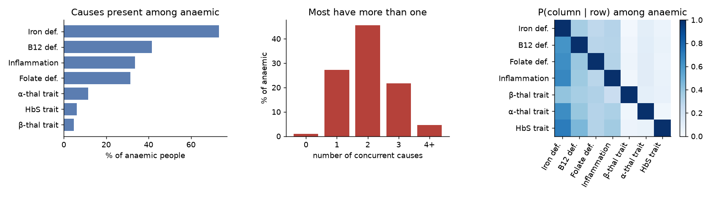
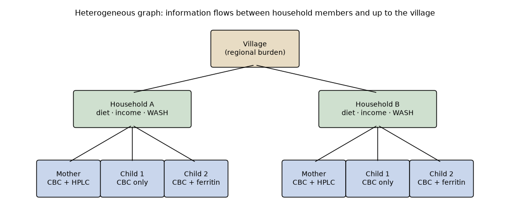
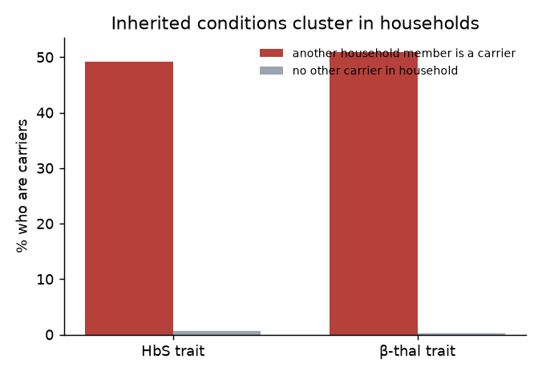
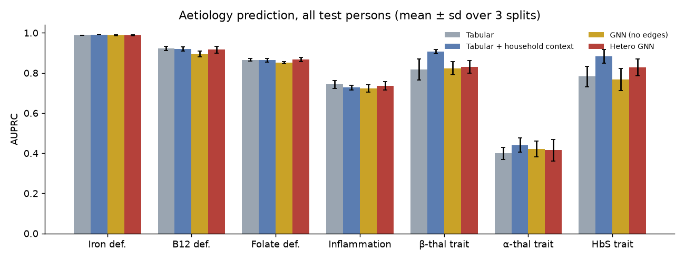
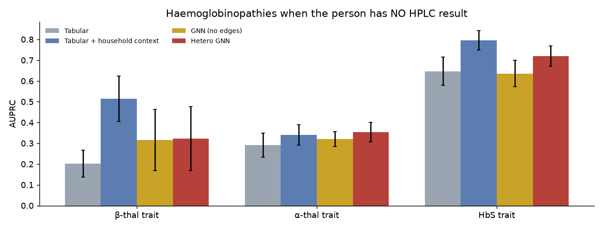
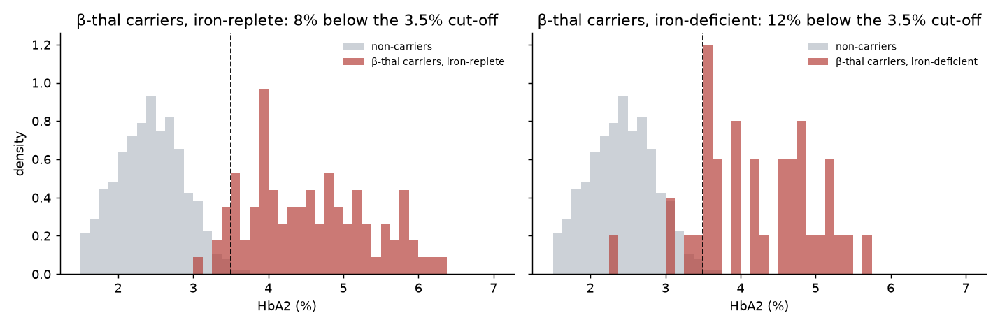

# Graph ML for multifactorial anaemia (synthetic-data prototype)

Anaemia is rarely one disease. In a typical anaemic person, iron deficiency, B12/folate deficiency,
inflammation and inherited haemoglobin disorders overlap, and the causes cluster in households
(shared diet, water and sanitation, and inherited carrier status). This prototype asks:
**can a graph over village → household → person improve aetiology inference when many specialised tests are missing?**

> **Status:** prototype on *synthetic* data with planted ground truth. Not clinical software, and results
> reflect the generator's assumptions. The plan is to swap in PRAKASH data later (same column names).

## 1. The problem: anaemia is multifactorial



*Left: causes among anaemic people. Middle: about 3 in 4 have two or more concurrent causes. Right: co-occurrence;
for example, most B12/folate-deficient and HbS-trait anaemic people are also iron deficient.*

## 2. The graph



Each person is a node with their CBC and whichever specialised tests they happened to get (ferritin, sTfR, CRP, B12,
folate, HbA2/HbF/HbS, sickling test) plus a missingness mask. Household nodes carry consumption/WASH covariates;
village nodes are learnable embeddings. A 2-layer GraphSAGE passes messages person ↔ household ↔ village, so an
untested child can borrow evidence from a tested sibling or parent.

**Why this matters for inherited conditions:**



## 3. Synthetic data (`gen_data.py`)

1,500 households, 6,759 people, 37.7% anaemic. Seven latent causes (iron, B12, folate, inflammation, β-thal trait, α-thal trait,
HbS trait). Specialised tests are done selectively (e.g. HPLC mostly if microcytic), so only ~30% have HPLC.
Realism knobs: 35% of β-thal carriers have *borderline* HbA2 (~3.8%), deficiencies depress HbA2 (masking), HbS/β-thal
compounds, noisy red-cell indices. Households split into train/val/test (no family leakage); 3 seeds.

## 4. Results





| AUPRC (mean over 7 causes) | All test persons | No HPLC result |
|---|---|---|
| Tabular (person + household covariates) | 0.788 | 0.669 |
| GNN without edges (ablation) | 0.782 | 0.680 |
| Hetero GNN (village-household-person) | 0.798 | 0.703 |
| Tabular + hand-engineered household context | **0.819** | **0.739** |

**Take-aways (honest version)**
- Iron, B12, folate and inflammation are decided by each person's *own* labs; the graph adds almost nothing there.
- Household structure helps most for **inherited** conditions when HPLC is missing (HbS trait AUPRC 0.64 → 0.72 with message
  passing vs. no edges).
- A gradient-boosted model given leave-one-out household aggregates **matches or beats the GNN**. The value is
  in using household structure, not necessarily in a GNN.
- β-thal without HPLC stays hard for the GNN (0.32, high variance since only ~2.7% prevalence).
  Full tables: [`tables.md`](tables.md).

## 5. Can we detect haemoglobinopathies?



| Screen | Sens | Spec | PPV |
|---|---|---|---|
| HbS > 20% (HPLC) → HbS trait | 1.00 | 1.00 | 1.00 |
| Sickling solubility test → HbS trait | 0.95 | 0.99 | 0.92 |
| HbA2 > 3.5% → β-thal trait | 0.91 | 1.00 | 0.94 |
| … iron-deficient only | 0.88 | 1.00 | 1.00 |
| CBC only: Mentzer < 13 & MCV < 80 → β-thal | 0.44 | 0.96 | 0.25 |
| CBC only → any thal trait | 0.26 | 0.98 | 0.59 |
| Microcytosis with normal HbA2 → α-thal | 0.29 | 0.94 | 0.45 |

- **HPLC is the workhorse** for HbS and β-thal; CBC indices alone (Mentzer) miss most carriers.
- Borderline HbA2 and iron/B12 deficiency push some β-thal carriers under the 3.5% cut-off (see the dashed line above).
- **α-thal trait** has no HPLC signature and is the hardest target for every method (AUPRC ≈ 0.4; DNA testing needed in practice).
- Compound HbS/β-thal (11 people) is too rare to evaluate separately.

## Reproduce

```bash
pip install -r requirements.txt
python gen_data.py      # writes persons.csv, households.csv (seeded)
python train.py         # ~70 s on CPU; writes results.md / results.json
python make_figures.py  # figures/ and tables.md
```

## Limitations and next steps
- Synthetic data; effect sizes are my assumptions. Not modelled: HbE, δ-thal, iron overload, CKD, malaria, age-specific norms.
- Next: calibration and uncertainty (ensembles), kinship edges (mother-child), real PRAKASH data, and a decision-focused
  metric (which test to order next).
